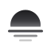
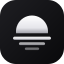
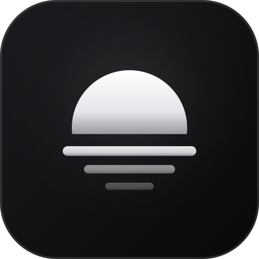
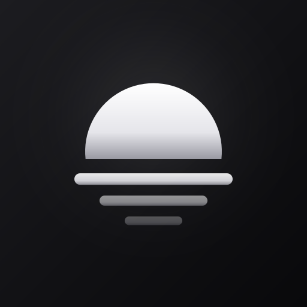
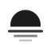

   
  <picture>
    <source media="(prefers-color-scheme: dark)" srcset="./svg/lune-lockup-dark.svg" />
    <source media="(prefers-color-scheme: light)" srcset="./svg/lune-lockup-light.svg" />
    
  </picture>

  
<strong>Visual Identity, Horizon Marks &amp; Design Tokens</strong>

  
The single source of truth for Lune's visual system across web, server, Unraid, and native clients.

  

    
    
    
    
  

  

    <a href="BRAND.md"><strong>Brand Guidelines</strong></a> ·
    <a href="https://github.com/LuneServer/lune"><strong>Lune Server</strong></a> ·
    <a href="https://github.com/LuneServer/lune-web"><strong>Web Client</strong></a> ·
    <a href="https://github.com/LuneServer/unraid-templates"><strong>Unraid Template</strong></a>
  

---

## Horizon Mark & Assets

The Lune Horizon mark depicts a moon rising above a widescreen horizon with three progressively tapering reflection bars.

| Asset | Preview | Usage |
|---|---|---|
| [`svg/lune-mark.svg`](svg/lune-mark.svg) |  | Primary Horizon mark for dark UI surfaces |
| [`svg/lune-mark-light.svg`](svg/lune-mark-light.svg) |  | Primary Horizon mark for light UI surfaces |
| [`svg/lune-favicon.svg`](svg/lune-favicon.svg) |  | Optically adjusted mark for 16–32px browser favicons |
| [`svg/lune-app-icon.svg`](svg/lune-app-icon.svg) |  | Pre-rounded app icon (raster exports in `png/` at `1024`, `512`, `192`) |
| [`svg/lune-avatar.svg`](svg/lune-avatar.svg) |  | Full-bleed square avatar for GitHub, iOS & Unraid (`png/lune-avatar-512.png`, `1024`) |
| [`svg/lune-lockup-dark.svg`](svg/lune-lockup-dark.svg) |  | Horizontal mark + wordmark for dark surfaces |
| [`svg/lune-lockup-light.svg`](svg/lune-lockup-light.svg) |  | Horizontal mark + wordmark for light surfaces |
| [`svg/lune-mark-mono-light.svg`](svg/lune-mark-mono-light.svg) / [`mono-dark`](svg/lune-mark-mono-dark.svg) |   | Single-color marks for watermarks & stamps |

---

## Color Palette

Lune uses calm, neutral obsidian surfaces and monochrome Lunar Silver chrome so media artwork carries the color.

| Role | Token | Dark Hex | Usage |
|---|---|---|---|
| **Canvas** | `--lune-canvas` | `#09090B` | Primary Obsidian application background |
| **Surface** | `--lune-surface` | `#141417` | Graphite cards, sidebars, and panels |
| **Elevated** | `--lune-elevated` | `#1E1E22` | Charcoal popovers, hover states, and modals |
| **Hairline** | `--lune-hairline` | `#2C2C31` | Structural borders and dividers |
| **Primary Ink** | `--lune-ink` | `#F5F5F7` | Lunar Silver primary text |
| **Secondary Ink** | `--lune-ink-secondary` | `#A1A1A6` | Supporting copy and metadata |
| **Accent** | `--lune-accent` | `#FFFFFF` | Primary CTAs & progress bars (pair with `#09090B` ink) |
| **Telemetry** | `--lune-telemetry` | `#64D2FF` | Restrained live/telemetry/Direct Stream accent |
| **Healthy / Warn / Danger** | `--lune-healthy` / `warning` / `danger` | `#30D158` / `#F5C451` / `#FF6961` | Status & alert tones |

See [`BRAND.md`](BRAND.md) for full light-mode tokens, typography rules, clearspace requirements, and usage do's & don'ts.

---

## Design Tokens

- **Web / CSS:** [`tokens.css`](tokens.css) provides `--lune-*` CSS custom properties for dark default and `[data-theme="light"]`.
- **Native / Cross-Platform:** [`tokens.json`](tokens.json) provides W3C Design Tokens format for future native clients (`lune-ios`, `lune-tv`, `lune-android`).

---

## License

See [LICENSE](LICENSE) for brand asset and design token licensing terms.
